# TRAIL: Tamper-evident Records for Agent Interactions and Liveness

> Generated from [`TRAIL_visuals.html`](TRAIL_visuals.html) by `tools/visuals/build.sh`; do not edit by hand. The animations play slower than on the interactive page. The draft itself is [`draft-nassar-agentproto-trail.md`](draft-nassar-agentproto-trail.md).

TRAIL is an IETF draft that makes agent-to-agent and agent-to-tool communication auditable and revocable. Wherever agents run, an edge signs a record of each action an agent takes, keeps those records in a trail nobody can quietly change, and stops the agent’s traffic if the parties it answers to can’t currently see it. TRAIL doesn’t decide whether an action is safe. It lets the parties that do decide approve, refuse, or stop actions, and see the records they need to judge them.

Kareem Nassar, Suhas Nandakumar, and Cullen Jennings. Draft: `draft-nassar-agentproto-trail`.

## How to read the pictures

Every animation uses the same layout: companies (operators) at the top, the evidence plane below them, and the parties that read it at the bottom. The same colors mean the same thing everywhere.

- **Machine**: the physical or virtual host
- **Sandbox**: where the agent runs
- **Cell**: everything behind one edge
- **Agent**: the AI (model + tools)
- **Edge**: where traffic leaves the cell
- **Attestation level**: under each edge, with its form
- **Operator**: the company running the cells
- **Action Record** (A1, B1: edge and number)
- **Evidence plane**, with one box per trail, state, or set of directed records
- **Authority**: e.g. Regulator R
- **Witness**: e.g. Notary N
- **Service** outside TRAIL
- **Not in the draft yet**

**Names and roles.** Parties are labeled with an example name, like Regulator R. The `yellow mono` text under it is the role from the draft. Chips on top of an edge show what that edge currently holds, like the latest copy of R’s state.

## How it works

Each building block below changes one thing in the same picture. The scenarios later are built only from these.

### The pieces and their names

Operators run agents in sandboxes on machines. The edge is where traffic leaves the cell. Each edge writes a record to its trail on the evidence plane before a call leaves; Regulator R publishes rules there, and Notary N cosigns trails.

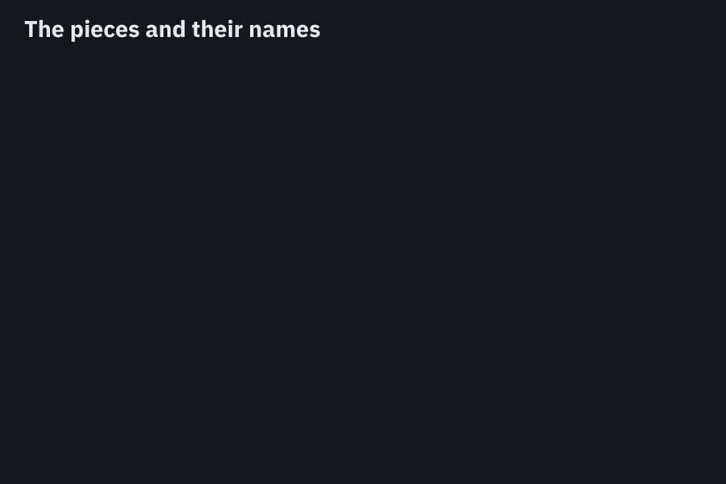

*In the draft: terminology (1.7); architecture (2)*

### The draft’s terms, in plain words

| Term | What it is |
|---|---|
| sandbox | Where an agent runs: a container, microVM, or similar. |
| cell | Everything behind one edge: a sandbox, a confidential VM, or a whole machine. |
| edge | Where traffic leaves the cell. Holds the keys, checks rules, signs, records, and blocks. |
| attestation level | `software`, `tee`, or `isolated`: who can read the edge’s key, and what can go around it. |
| verifier | Checks what holds an edge’s key and issues an Attestation Result (from RATS). |
| agent, principal, operator | The AI; the person it acts for; the company running it. |
| Action Record | The signed record of one action, written to the trail before the call leaves. |
| trail, checkpoint | An edge’s records in order; a signed summary closing each stretch of it. |
| evidence plane | Where trails, state, and directed records are published: a MoQ relay or HTTP servers. |
| state | What each party republishes on a schedule: an authority’s rules, an operator’s grants, an edge’s level. |
| directive | A rule in an authority’s state: `policy`, `hold`, `freshness-budget`, `require-gate`, `require-witness`, `require-level`, `require-admission`, `require-record`. |
| directed record | A record published for one party, which can be encrypted to it: gate requests, approvals, disclosures. |
| grant | A right an operator gives an authority: which directives it may issue, for what, and which fields it may read. |
| authority, witness | Sets rules within its grants; checks trails are complete and cosigns them. |
| admission issuer, admission token | A party that hands out a fixed number of tokens; the token an agent’s records cite. |

### Where the edge is decides the attestation level

The agent always runs in a sandbox. What changes is where the edge sits, and so what the cell contains. Watch Machine A change level: as a sidecar (software), the host can read the edge’s key and a sandbox escape goes around it; inside a confidential VM (tee), the key is hidden but an escape into the VM still goes around it; as a DPU on the network card (isolated), neither works. Verifier V checks which it is, Edge A publishes the result in its state, and Edge B reads it.

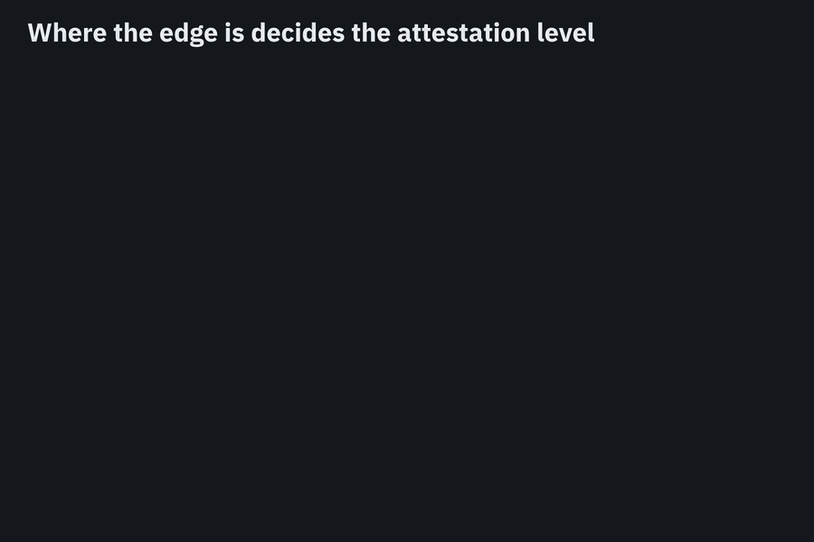

*In the draft: attestation levels (2.1); attestation (11.4)*

### Every call leaves records on both sides

Edge A writes A1 to its trail before the call leaves. Edge B checks A1 and writes B1 citing it; the reply carries B2, and Edge A writes A2 citing that. Each trail ends up with a record citing the other side’s.

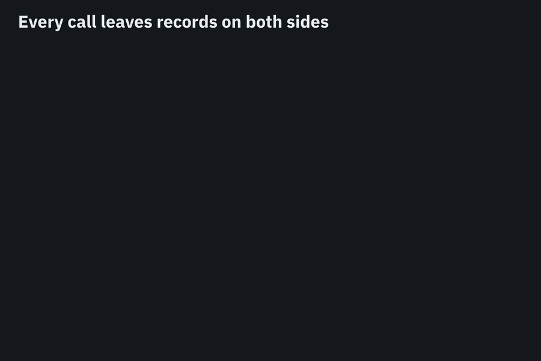

*In the draft: Action Record (3); core rule (4)*

### What makes records tamper-evident

Each record is signed, linked into its trail, closed by a checkpoint that a notary cosigns, and cited by the other side. Changing a record, removing one, or publishing a second version each breaks one of those.

*In the draft: what makes records tamper-evident (8.5)*

### An authority’s rules: policy and hold

An authority publishes its rules in its state; the draft calls them directives. A `policy` says what’s allowed, and a `hold` stops matching actions. Both act as soon as the edge has them.

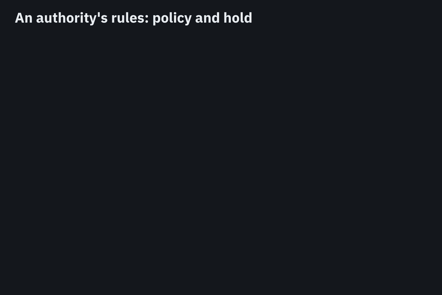

*In the draft: state snapshots (9.1); how directives act (9.2)*

### An authority’s rules: freshness-budget

A `freshness-budget` says how old the edge’s copy of the authority’s state may get before each kind of action stops. Unlike a policy or hold, it acts only when the authority goes quiet.

*In the draft: freshness rules (9.3); budgets (9.4); degraded mode (9.5)*

### An authority’s rules: require-gate, using directed records

A `require-gate` makes the edge hold an action until the authority approves. The request and the approval travel as directed records: records published for one party, which can be encrypted to it. A gate can cover every action an agent takes; then everything waits for the authority.

*In the draft: gates (10.1); directed records (5.3, 6.3)*

### Grants: what an operator lets an authority do

An authority can only act within the rights an operator grants it. Grants are in the operator’s own signed state. Here Operator X grants Regulator R the right to hold; Operator Y doesn’t, so R’s hold stops Agent A and not Agent B.

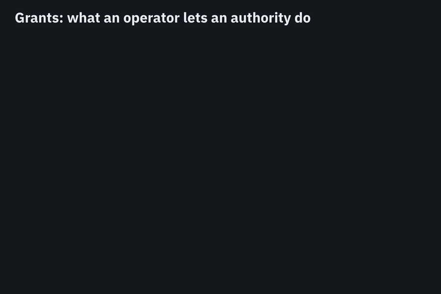

*In the draft: grants (9.1)*

### Witnesses and authorities do different jobs

Notary N checks that it has every record and cosigns; it has no rights over actions. Its cosignatures matter because an authority’s rule, `require-witness`, makes Edge B refuse A’s calls when A’s trail hasn’t been cosigned recently.

*In the draft: authorities and witnesses (2.2); freshness rules (9.3)*

### Disclosure: one record, a view per authority

Records hide sensitive fields. Edge A sends the hidden fields only to the authorities whose grant covers them, as directed records encrypted to them. The disclosure is itself recorded.

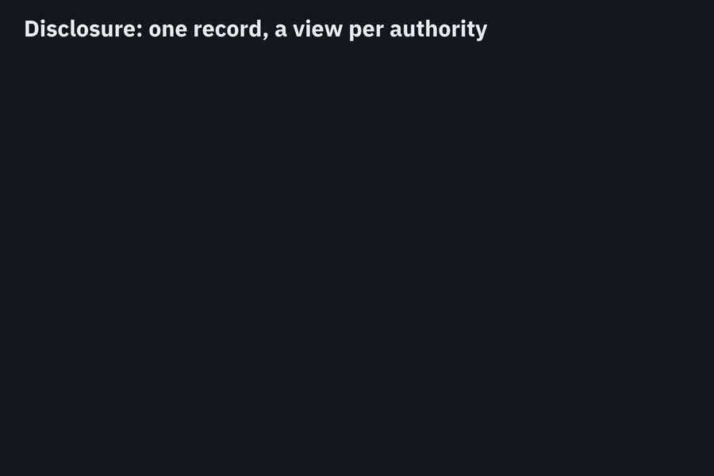

*In the draft: selective disclosure (3.4); disclosure on request (10.3)*

### Admission tokens: a cap across machines

An admission issuer hands out a fixed number of tokens and publishes which are valid. Each agent’s records cite its token; edges refuse calls whose records cite no valid token.

*In the draft: admission and counting (10.2)*

## MoQ and HTTP

Everything above works over either binding. These two blocks show where they differ.

### Killswitch: MoQ and HTTP compared

A hold used to stop agents at once. Both operators granted Regulator R the right to hold. Over MoQ the hold is pushed to the edge; over HTTP the edge sees it at its next poll, so a few calls still leave.

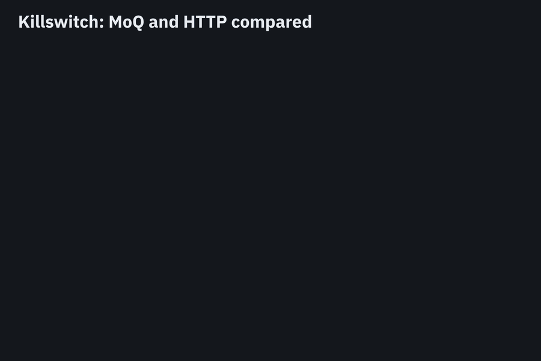

*In the draft: why MOQT (2.4); HTTP state (6.3)*

### Seeing machines nobody announced

A regulator should see every machine an operator runs, including ones the operator didn’t mention. Over MoQ it subscribes once to the whole swarm. Over HTTP it learns of new machines from the notaries’ cosignatures, because a machine can’t act without one.

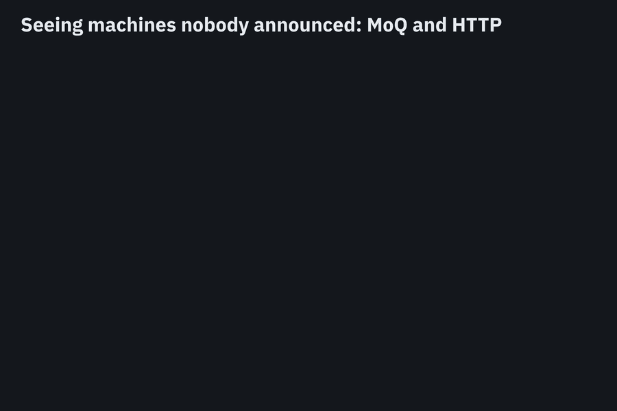

*In the draft: namespaces (5.2); trails as static tiles (6.2)*

## What you can build with it

Eight scenarios built from the blocks above. Each lists the blocks it uses. Parts the draft doesn’t define yet are drawn as dashed red boxes.

### 1. An independent monitor

Today a monitor runs inside the agent’s machine; if it crashes, the agent keeps going. Here Monitor M is outside both operators and is both an authority and a witness, so its silence stops Agent A.

**Verdict:** Works, with limits

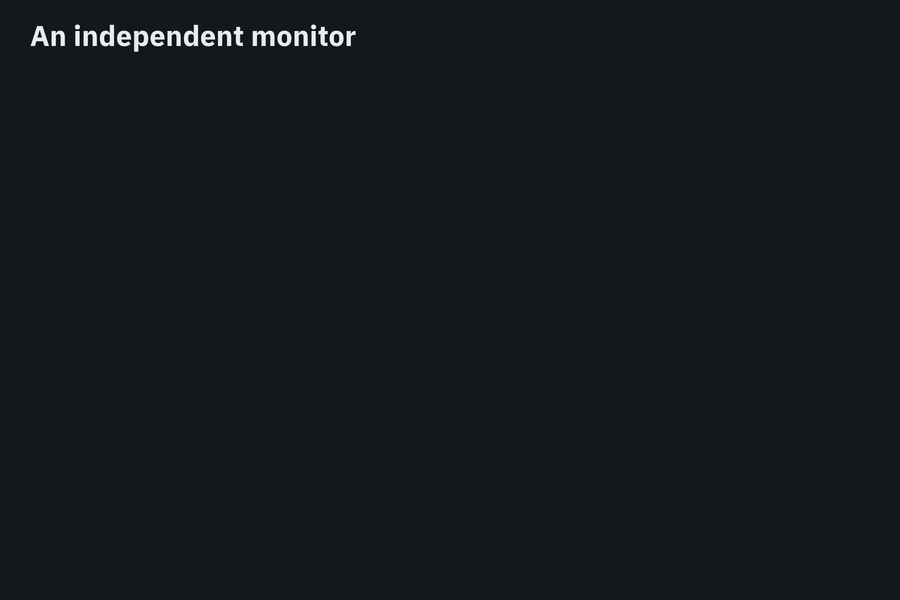

**Uses:** [freshness-budget](#an-authoritys-rules-freshness-budget), [witnesses and authorities](#witnesses-and-authorities-do-different-jobs)

**Missing:** letting the monitor replace an action rather than only block or approve it (draft Appendix D.2). Freshness shows the monitor is reachable and receiving, not that it reviewed anything.

### 2. Limiting how many agents can run

An agent copies itself. The copy has no admission token, so TRAIL peers refuse it. A server that doesn’t run TRAIL still answers, but the copy’s calls are in A’s trail.

**Verdict:** Works, with limits

**Uses:** [admission tokens](#admission-tokens-a-cap-across-machines), [records on both sides](#every-call-leaves-records-on-both-sides)

**Missing:** metered tokens for spend and API budgets (Appendix D.5).

### 3. Stopping a prompt-injection worm

An injection spreads from Agent A to Agent B at another company. Records cite what was received, so Regulator R can follow the path and hold both agents by name.

**Verdict:** Partly works

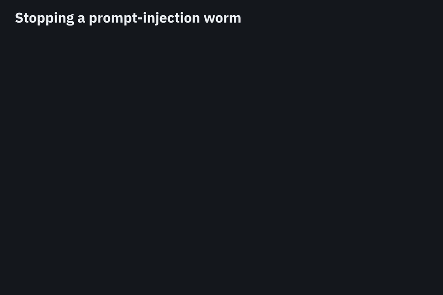

**Uses:** [records on both sides](#every-call-leaves-records-on-both-sides), [policy and hold](#an-authoritys-rules-policy-and-hold), [grants](#grants-what-an-operator-lets-an-authority-do)

**Missing:** a hold that matches everything descending from an input (Appendix D.1). The edge sees what an agent received, not what the model used.

### 4. Cutting off a compromised tool server

One hold from Security team T naming the server stops every company that granted T that right.

**Verdict:** Works

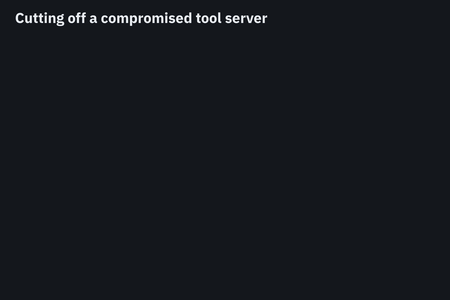

**Uses:** [policy and hold](#an-authoritys-rules-policy-and-hold), [grants](#grants-what-an-operator-lets-an-authority-do)

### 5. Allowing less when oversight lags

Each kind of action needs a more or less recent cosignature. As Notary N falls behind, risky actions stop first.

**Verdict:** Works

**Uses:** [freshness-budget](#an-authoritys-rules-freshness-budget), [witnesses and authorities](#witnesses-and-authorities-do-different-jobs)

### 6. A person at another company approves an action

Bank K is an authority with a gate on wires to it. Officer O approves with a passkey; the wire’s record cites the approval.

**Verdict:** Needs one addition

**Uses:** [gates and directed records](#an-authoritys-rules-require-gate-using-directed-records), [grants](#grants-what-an-operator-lets-an-authority-do)

**Missing:** how a passkey (WebAuthn) signature becomes an approval record (Appendix D.3).

### 7. Reporting an incident without customer data

Safety institute S checks a record against the cosigned trail and sees what happened, without seeing the customer.

**Verdict:** Works, with limits

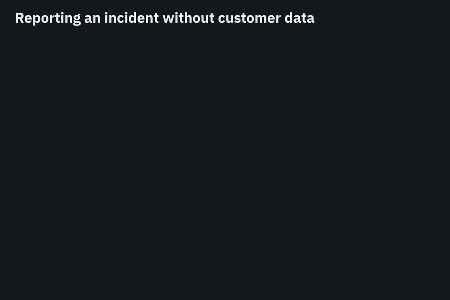

**Uses:** [tamper evidence](#what-makes-records-tamper-evident), [disclosure](#disclosure-one-record-a-view-per-authority)

### 8. Proving which model was used

The model server publishes which model it is attested to run. The edge records it and refuses a swapped model.

**Verdict:** Needs two additions

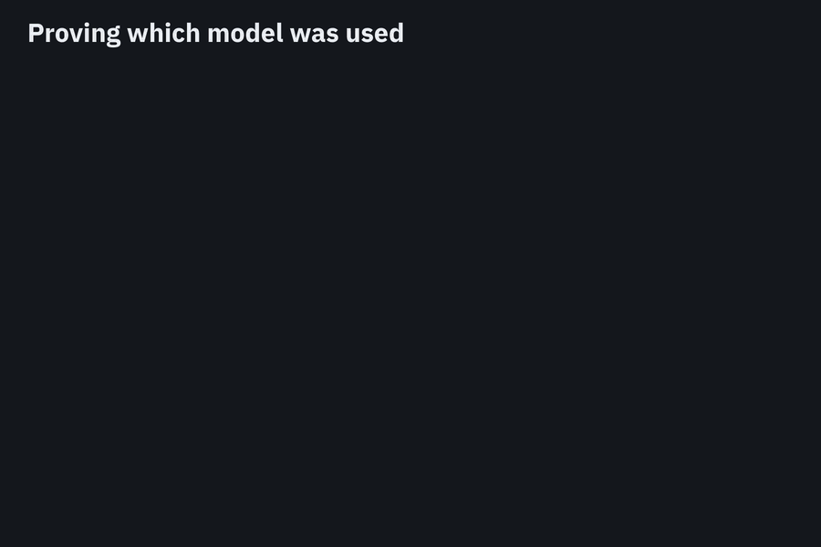

**Uses:** [attestation levels](#where-the-edge-is-decides-the-attestation-level), [records on both sides](#every-call-leaves-records-on-both-sides)

**Missing:** a cite of the server’s attestation, and a claim naming the model (Appendix D.4).

## What TRAIL doesn’t cover

- **Blocking oversight can stop agents**: If an attacker cuts off the regulator, agents stop. Per-action time limits, short grace periods, several notaries, and backup paths reduce the damage.
- **Agents that bypass the edge**: At the software and tee levels, an agent that escapes can go around the edge. TRAIL peers still refuse its unsigned calls; other servers won’t.
- **A false record made at the start**: Tamper-evident isn’t tamper-proof. A compromised edge can sign a false record; the attestation level, the other side’s records, and the notaries limit how far it goes.
- **Deciding what is safe**: TRAIL defines no way to judge an action. An authority judges with its own tools, and acts through TRAIL: a gate before the action, a policy as it happens, a hold afterwards. It sees content only through disclosures its grant covers.

## Where the page and the draft differ

Section numbers refer to `draft-nassar-agentproto-trail`.

| Topic | In the revised draft | Status |
|---|---|---|
| Sandbox | Added to §1.7 | Done in the revised draft |
| Cell, edge | Redefined in §1.7: everything behind one edge; where traffic leaves the cell | Done |
| Attestation levels | §2.1 table: where the edge is, what the cell is, who can read the key, what goes around it | Done |
| Authorities and witnesses | §2.2 added; a witness acts only through require-witness | Done |
| Directed records, grants, admission issuer | Added to §1.7 | Done |
| How directives act | §9.2 table: immediate, per action, or when state goes stale | Done |
| Gate on every action | §10.1: everything waits, and stops if the approver is unreachable | Done |
| Disclosure outside a grant | §10.3: refused and recorded | Done |
| Who can read trails | §12.2: authorized parties only; §6.2 fixed | Done; who runs the authorization server is an open issue |
| Verifier | §11.4 unchanged: the edge carries the Attestation Result | Open issue: whether verifiers also publish |
| Requiring a sender’s grants | Not specified | Open issue |
| Killswitch, A1/B1 numbering | Page only | The draft keeps *hold* |
| Scenario additions | Appendix D proposals | Open issue: which to specify |

Kareem Nassar, Suhas Nandakumar, and Cullen Jennings. Revises Suhas Nandakumar’s earlier TRAIL draft.
